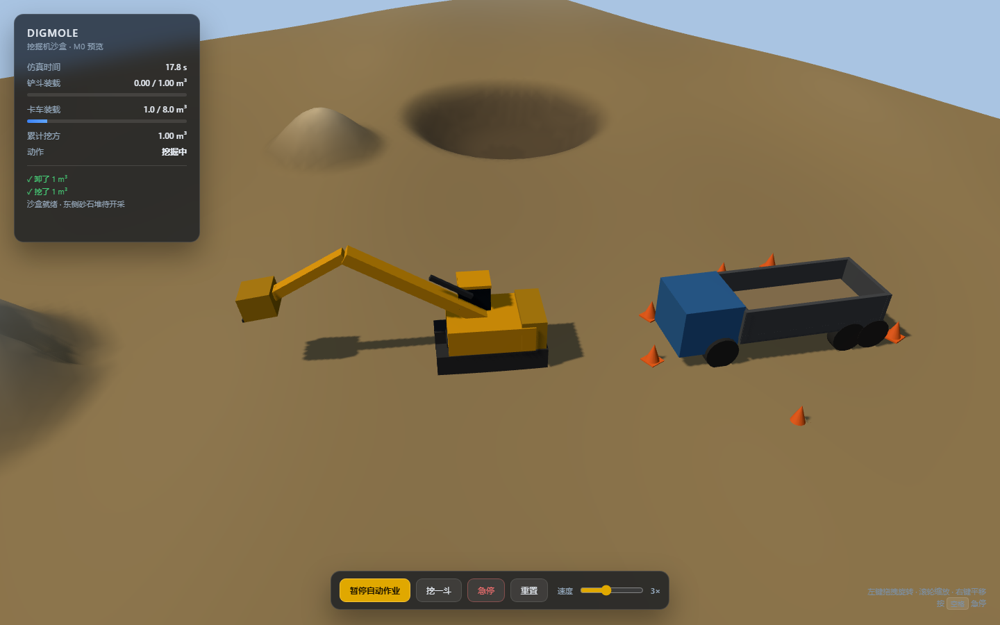

# DigMole · 挖掘机沙盒

> 你给目标，agent 把挖掘机真的开起来。
> 这不是挖掘机模拟器，是「具身智能沙盒」——左边看它干活，右边看它怎么想。

**当前状态**：M0 无头仿真内核 + 浏览器 3D 预览都已跑通（19 个测试通过，体积守恒误差 < 0.01 m³），Pi SDK 接入 spike 4/4 通过。



---

## 现在能跑什么

```bash
pnpm install

pnpm dev     # 浏览器 3D 预览 → http://127.0.0.1:5180/
pnpm demo    # 无头仿真：挖 9 斗、装满一辆卡车、校验体积守恒，最后打印地形
pnpm test    # 19 个单元/集成测试
pnpm spike   # Pi SDK 接入验证（4 个风险点）
pnpm typecheck
```

浏览器里可以鼠标拖拽旋转、滚轮缩放，点「开始自动作业」看它自己挖土装车；`?auto=1` 打开即自动开始。

`pnpm demo` 的真实输出（节选）：

```
[2] → scoop {"targetId":"pile-east"}
    ✓ 挖了 1 m³  (3 ms, sim t=5.1s)
[3] → scoop {"targetId":"pile-east"}
    ✗ [BUCKET_FULL] 铲斗已装满（1 m³），先卸料
[4] → dump_to {"targetId":"truck-01"}
    ✓ 卸了 1 m³  (1 ms, sim t=13.5s)
...
[20] → dump_to {"targetId":"truck-01"}
    ✗ [TRUCK_FULL] 「自卸卡车 01」已经装满了

    体积守恒检查: 挖 9.00 = 地面 0.00 + 卡车 8.00 + 斗 1.00  误差 0.001 m³
```

> 注意 `[3]`：满斗再挖会被明确拒绝，而不是默默失败或卡死。**每个动作都必须能说出失败原因**，这是让 agent 可信的前提。

---

## 架构

```
浏览器（后面做）                    Node 服务端（权威）                      外部
┌───────────────────┐  WS 状态/事件 ┌──────────────────────────┐  MCP/HTTP ┌──────────┐
│ 左：3D 视口        │ ◀────────────│ 仿真 Sim 60Hz（确定性）    │ ◀─────────│ 任意 agent│
│ 右：目标/追踪/接管 │ ── 遥控/接管 ─▶│  ├ World 目标注册表        │           │ 框架      │
└───────────────────┘               │  ├ 执行器（generator 状态机）│           └──────────┘
                                    │  └ 工具层 ══ 同一套入口 ══╗
                                    │ 内置 Pi agent 循环 ────────╝
                                    └──────────────────────────┘
```

工具层是**唯一入口**：内置 agent 和外部框架都走同一套 `observe / drive_to / scoop / dump_to / level / abort`。这样不会出现「内置能开、外部接不上」的漂移。

仿真核心（`packages/sim`）是**纯 TypeScript，不碰 DOM、不碰 Three.js、不碰 Node API**，所以浏览器和服务端都能直接 import。

---

## 目录

```
packages/sim/          纯逻辑仿真核心（唯一真相）
  src/math.ts          无依赖数学工具
  src/terrain.ts       高度场地形：挖、堆、体积统计
  src/machine.ts       挖掘机运动学：正解 / 两连杆解析 IK / 关节限速
  src/world.ts         沙盒场景 + 目标注册表（语义层）
  src/task.ts          generator 协程 + 超时 + 中断
  src/actions.ts       动作：scoop / dump / drive / level
  src/sim.ts           固定步长调度、快进、快照、急停
  src/tools.ts         6 个工具的定义（zod 校验 + JSON Schema）
  test/                19 个测试
apps/web/              浏览器 3D 预览（Three.js + Vite，纯前端跑仿真）
apps/cli/              无头命令行驱动（M0 验收）
spike/pi/              Pi SDK 接入验证
```

---

## 几个关键设计决定

这几条都是踩过坑之后的选择，不是默认做法。

**1. 不用物理引擎算挖机。**
六关节刚体 + 液压约束调参能调到怀疑人生。这里用解析 IK（回转角 + 大臂小臂余弦定理）+ 关节角速度限速。稳定、确定、可控，而且手感更像真机——真机本来也是「推杆 → 关节匀速转动」。

**2. 高度场 + 体积守恒，不用体素。**
每个顶点视为占有一个 `cell²` 的单元，挖走多少、堆回多少都可精确记账。`挖 = 地面 + 卡车 + 斗` 这条等式就是回归测试。体素好看但性能与打磨成本高一个数量级。

**3. 给 agent 的是宏动作，不是关节控制。**
`scoop` 内部是「行驶 → 对位 → 下挖 → 拖斗 → 收斗」一整套，耗时约 5 秒仿真时间。让 LLM 以 10Hz 闭环控制机械臂是几乎必死的方案。

**4. 世界模型是语义层。**
指令里出现的是 `pile-east`、`truck-01`，不是坐标。这是 LLM 能安全参与的前提：它只认名字和体积，不认浮点。

**5. 确定性 + 无头。**
固定步长、无随机、无系统时钟。同样的动作序列永远得到同样的地形——这是回放、回归测试和 agent 调试的地基。

**6. 急停用 `generator.throw()`。**
动作是 generator，中断时把异常抛进去，`finally` 块正常执行（清掉行驶目标等）。比「设个 flag 然后到处检查」干净得多。

---

## Pi SDK 接入验证

结论：**可以用，而且要按「引擎」用，不按「产品」用。**

| 风险点 | 结果 | 证据 |
|---|---|---|
| 只暴露挖掘工具，禁掉 bash/文件 | ✅ | `noTools:"all"` + `customTools` → active = `[observe, scoop, dump_to, drive_to, codemode]` |
| codemode 沙箱里 `await` 长耗时工具 | ✅ | 沙箱内执行 `scoop`，真实地形挖方 1.00 m³ |
| 沙箱无法访问文件系统 | ✅ | `import("node:fs")` → `could not load module 'node:fs'` |
| 事件流可用（喂右侧 trace 面板） | ✅ | `session.subscribe()` 正常 |

`codemode` 是这套方案最值钱的东西：它让模型写一段 JS 把重复作业**一次调用**做完——

```js
for (let i = 0; i < 8; i++) {
  await tools.scoop({ targetId: "pile_east" });
  await tools.dump_to({ targetId: "truck_1" });
}
```

八斗活 = 一次 LLM 往返。沙箱是 QuickJS，无文件、无网络、无定时器。

---

## 路线

| 阶段 | 内容 | 状态 |
|---|---|---|
| **M0** | 无头仿真内核 + 工具层 | ✅ 完成 |
| **M0.5** | Pi SDK 接入验证 | ✅ 完成 |
| **M0.8** | 浏览器 3D 预览（纯前端、单机跑仿真） | ✅ 完成 |
| **M1** | 服务端权威仿真 + WebSocket 同步 + 人工遥控 | 下一步 |
| **M2** | 内置 agent 循环 + 右侧工作台（目标 / 追踪 / 接管） | |
| **M3** | 工具层暴露为 MCP，接外部 agent 框架 | |
| **M4** | 沙盒内容（物料、订单）与打磨（音效、相机、后处理） | |

现在的 3D 预览已经是**同一个 `packages/sim`** 在浏览器里跑，所以 M1 要做的不是「重写渲染」，而是把权威仿真搬到服务端、加一层状态同步——渲染层几乎不用动。

---

## 已知限制

- 场景里没有碰撞：挖掘机不会撞上卡车，也不会被土堆挡住（视觉上会重叠）。
- 3D 模型是程序化搭的方块，只为验证姿态和闭环，不是美术资产。
- 平整（`level`）是「挖最高点填最低点」的朴素策略，不是真正的推土刀法。
- 多台机器、燃料、磨损都还没有。
- 还没接真实 LLM：`pnpm spike` 验证的是接线与沙箱，不是模型决策质量。
